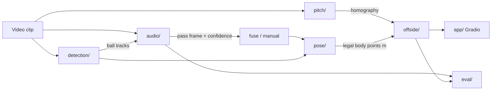

# Architecture

Student research prototype: semi-automated offside detector for short single-camera broadcast clips. Compared in the paper against traditional VAR workflows (manual scrubbing + multi-camera alignment).

## Pipeline overview

## Stages

| Stage | Role | Default backend | Fallback |
|-------|------|-----------------|----------|
| `audio/` | Kick/pass instant from spectrogram + onsets | librosa band-pass + peak pick | Visual ball motion; manual frame |
| `detection/` | Players, GK, ref, ball | RF-DETR Nano (Apache-2.0) | YOLO (AGPL-3.0) or `mock` |
| `pitch/` | Keypoints → homography to metres | Manual 4+ points / mock quad | HF model when user supplies a licensed checkpoint |
| `pose/` | Body keypoints; advanced legal point (no arms) | ViTPose (Apache-2.0) | `mock` from boxes; SAM 3D Body behind `--enable-sam3d` |
| `offside/` | Second-last defender line, margins, verdict | Pure geometry | — |
| `app/` | Gradio UI | mock backends for boot | Real models on Colab / Space with GPU |
| `eval/` | Paper metrics | CSV schema + scripts | Synthetic WAVs in CI |

## Novelty focus

The **audio pass detector** is the main novelty relative to typical vision-only pipelines: broadcast audio often carries a distinct impact transient. When crowd noise dominates, confidence drops and the system recommends visual / manual correction — evaluated as pass-frame error in frames and milliseconds.

## Design constraints

- Single camera → planar homography approximation (no multi-view triangulation like broadcast VAR).
- Runnable on **Google Colab free GPU** and on a laptop (CPU + mock backends).
- Each stage has a **CLI** and importable functions for independent testing.
